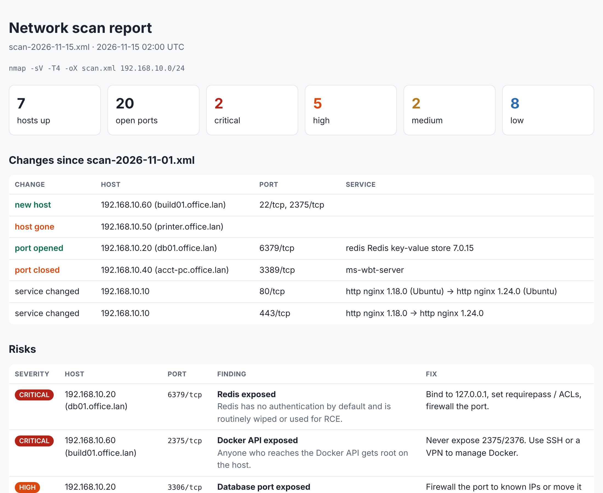

# nmap-report


Turns nmap XML output into a report a manager can read, flags risky exposed
services with a fix for each, and **compares two scans** so you see what
changed on the network since last time.

Python standard library only. Output as text, Markdown, JSON or a
self-contained HTML page.



```
$ nmap -sV -oX scan-2026-11-15.xml 192.168.10.0/24
$ nmap-report scan-2026-11-15.xml --diff scan-2026-11-01.xml --min-severity medium

Hosts up: 7   Open ports: 20   Risks: 2 critical, 5 high, 2 medium, 0 low

RISKS
  [CRITICAL] 192.168.10.20 (db01.office.lan)        6379/tcp   Redis exposed
             Bind to 127.0.0.1, set requirepass / ACLs, firewall the port.
  [CRITICAL] 192.168.10.60 (build01.office.lan)     2375/tcp   Docker API exposed
             Never expose 2375/2376. Use SSH or a VPN to manage Docker.
  [HIGH    ] 192.168.10.30 (nvr.office.lan)         8000/tcp   Hikvision SDK / service port exposed
             Do not port-forward CCTV devices. Use the vendor P2P service or a VPN, update firmware.
  ...

Changes from scan-2026-11-01.xml to scan-2026-11-15.xml
  + host  192.168.10.60 (build01.office.lan)  open: 22/tcp, 2375/tcp
  - host  192.168.10.50 (printer.office.lan)
  + port  192.168.10.20 (db01.office.lan)        6379/tcp   redis Redis key-value store 7.0.15
  - port  192.168.10.40 (acct-pc.office.lan)     3389/tcp   ms-wbt-server
  ~ svc   192.168.10.10                          80/tcp     http nginx 1.18.0 (Ubuntu)  ->  http nginx 1.24.0 (Ubuntu)
```

Example output for the bundled sample scans: [HTML](examples/report.html),
[Markdown](examples/report.md), [JSON](examples/report.json), [text](examples/report.txt).

## Why

nmap's own output is fine for one host, but on a /24 it is hard to answer the
questions that matter: *what is dangerous here?* and *what is new since last
month?* This tool answers both, and its `--fail-on` flag lets a scheduled scan
alert you when a database or a camera suddenly appears on the network.

## Risk rules

Rules match on the port number or on the service nmap detected (so Telnet on
port 2222 is still Telnet). Severity assumes the scanner sits where an
attacker would, e.g. a scan of your public IPs.

| Severity | Rules |
|----------|-------|
| critical | Docker API (2375/2376), Redis, MongoDB, Elasticsearch, industrial protocols (Modbus 502, S7 102, BACnet 47808, DNP3 20000) |
| high | Memcached, databases (MySQL, PostgreSQL, MSSQL, Oracle, CouchDB), Telnet, RDP, VNC, SMB/NetBIOS, MQTT, **Hikvision 8000**, **Dahua 37777** |
| medium | FTP, TFTP, SNMP, NFS/rpcbind, LDAP without TLS, MS RPC, RTSP camera streams |
| low | SSH, plain HTTP |

The CCTV rules come from real work installing and securing Hikvision and Dahua
systems: port-forwarded DVRs are one of the most common ways small businesses
end up in botnets. To avoid false positives, the Hikvision / Dahua rules only
fire when nmap's product string matches the vendor or no product was detected.

All rules live in [`nmap_report/rules.py`](nmap_report/rules.py) as plain
data, so adding one is a few lines.

## Install

```bash
git clone https://github.com/darkside0001/nmap-report.git
cd nmap-report
pip install .
# or without installing:
python3 -m nmap_report samples/scan-2026-11-15.xml
```

Requires Python 3.9+.

## Usage

```bash
nmap-report scan.xml                                  # text report
nmap-report scan.xml -f html -o report.html           # HTML report for a client
nmap-report scan.xml --diff last-month.xml -f markdown -o changes.md
nmap-report scan.xml -f json | jq '.risks[] | select(.severity=="critical")'
nmap-report scan.xml --min-severity high              # hide medium and low
```

### Weekly drift check with cron

```bash
#!/bin/sh
# /etc/cron.weekly/attack-surface
cd /var/lib/scans
nmap -sV -T4 -oX new.xml 203.0.113.0/28
if ! nmap-report new.xml --diff last.xml --fail-on high -f markdown -o report.md; then
    mail -s "Attack surface changed" soc@example.com < report.md
fi
mv new.xml last.xml
```

`--fail-on LEVEL` exits with `1` when a risk at that level or above exists,
or when `--diff` finds a newly opened port or a new host. Exit `2` means the
input file was missing or invalid.

## Safe handling of scan data

Banners and script output are written by the scanned devices, so they are
untrusted input. The tool:

- HTML-escapes every value in the HTML report and neutralises `|`, `<` and `>`
  in Markdown cells, so a hostile banner cannot inject script into the report
  (covered by a test);
- refuses XML files that declare entities, which blocks "billion laughs"
  style expansion.

## Tests

```bash
pip install -e .[dev]
pytest -q
# 13 passed
```

`samples/` holds two synthetic scans of an office network made by
`samples/generate_samples.py`, two weeks apart, with typical drift: a Redis
port opened on the database server, a forgotten Docker build host, an nginx
upgrade, a printer removed and RDP closed.

## Scope

Only scan networks you own or are authorised to test. This tool does not scan
anything itself: it reads the XML that nmap produced.

## License

MIT
